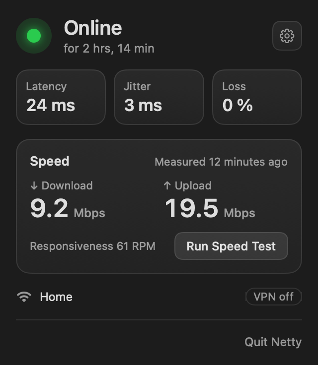
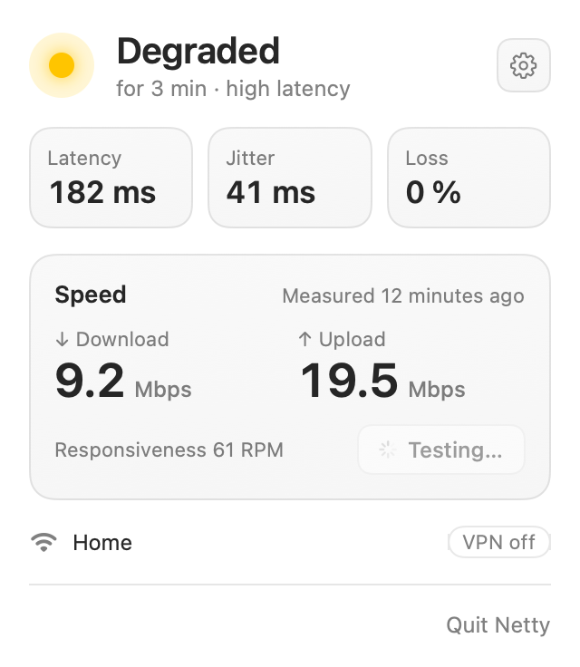
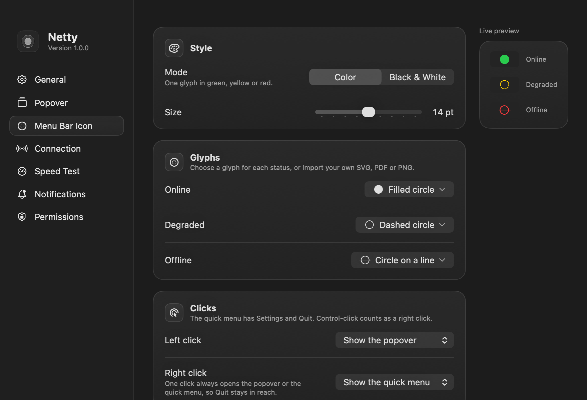
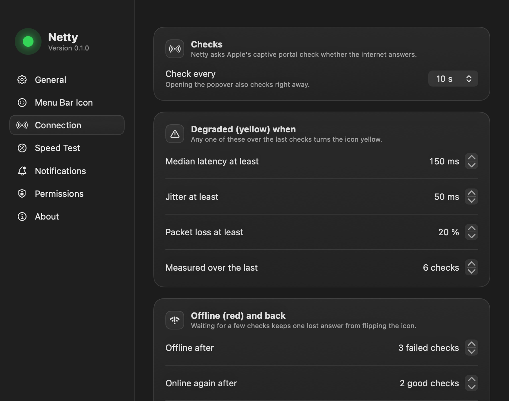

# Netty

Your network companion in the macOS menu bar. A dot that tells you at a glance whether you are really on the internet, how good the connection is, and how fast it is.

> Status: v0.1.0 (not yet notarized). See [`idea.md`](idea.md) for the design spec.

| Online | Degraded |
|---|---|
|  |  |

## Features

- **Real internet, not just a network.** Netty asks Apple's captive portal check (with Google's as a fallback) whether the internet answers. Wi-Fi without internet or a hotel login page counts as offline.
- **Green, yellow, red.** Yellow when latency, jitter or packet loss crosses a threshold; red after a few failed checks in a row. Every rule can be changed in Settings › Connection.
- **Latency, jitter and loss** from a TCP handshake with 1.1.1.1 and 8.8.8.8 every 10 seconds, and right away whenever you open the popover or the network changes.
- **Speed test** with Apple's built-in `networkQuality`: download, upload and responsiveness. It runs when you ask, or on a schedule (off by default; metered networks are skipped).
- **Notifications** when the connection drops and when it comes back, with how long you were offline. A degraded connection never notifies, and Focus modes are respected.
- **Network info:** Wi-Fi name (with Location access), Ethernet or hotspot, whether a VPN carries your traffic, and your local and public IP (click one to copy it).
- **Your popover, your order:** show, hide and drag its sections (Status, Quality, Speed, Network), and switch off single parts such as jitter, the VPN badge or either IP, in Settings › Popover, with a live preview.
- **Left and right click:** each opens the popover, a quick menu (Settings, Quit), a speed test or Settings, as you choose.
- **Menu bar icon your way:** color or black & white, a glyph per status (`● ◍ ◌ ◉ …`, SF Symbols or your own SVG, PDF or PNG) and its size.

| Menu Bar Icon | Connection |
|---|---|
|  |  |

## Install

Netty needs macOS 26 or later.

1. Download `Netty.dmg` from the latest release, open it and drag Netty to Applications.
2. Open Netty. It isn't notarized by Apple yet, so macOS stops it the first time: choose **Done**, then open System Settings › Privacy & Security and click **Open Anyway** next to “Netty.app” was blocked.
3. The welcome window explains and asks for the two optional permissions.

## Permissions

Both are optional; each only adds something to the popover.

- **Notifications:** connection lost / back online.
- **Location:** macOS shares the Wi-Fi network name only with apps that have Location access. Netty never reads your location.

Netty sends nothing anywhere: no analytics, no telemetry. Its checks go to Apple's captive portal page, Google's fallback, and Cloudflare's 1.1.1.1. The public IP comes from that same 1.1.1.1 (`/cdn-cgi/trace`, over HTTPS), only when you open the popover and at most every 5 minutes; hide it in Settings › Popover and it is never looked up.

## Build from source

Requires Xcode 26 and [XcodeGen](https://github.com/yonaskolb/XcodeGen).

```sh
xcodegen
xcodebuild -scheme Netty -derivedDataPath build build
open build/Build/Products/Debug/Netty.app
```

Tests live in the `NettyKit` package:

```sh
swift test --package-path Packages/NettyKit
NETTY_LIVE=1 swift test --package-path Packages/NettyKit   # also hits the real network and runs a speed test
```

The project builds with an ad-hoc signature, which changes on every build and makes macOS forget the Location permission. To keep it, copy `Config/Signing.local.xcconfig.example` to `Config/Signing.local.xcconfig` and set your team ID.

### Reviewing the UI without opening it

Debug builds render PNGs and quit:

| Variable | Renders |
|---|---|
| `NETTY_RENDER_POPOVER=<dir>` | The popover in each status, light and dark |
| `NETTY_RENDER_SETTINGS=<dir>` | Every Settings area and the welcome window, light and dark |
| `NETTY_RENDER_ICONS=<dir>` | Every glyph kind in each mode and status (`NETTY_ICON_CUSTOM=<file>` adds an image) |
| `NETTY_RENDER_MENUBAR=<dir>` | The real menu bar icon as the status bar draws it (`NETTY_ICON_MODE=monochrome`) |

## Release

`scripts/release.sh` builds the signed Release app for the version in `project.yml`, refuses a dirty tree or an untagged HEAD, and packs `dist/Netty.dmg`. `--upload` attaches it to the GitHub release for that tag.

## License

[GPL-3.0](LICENSE).
